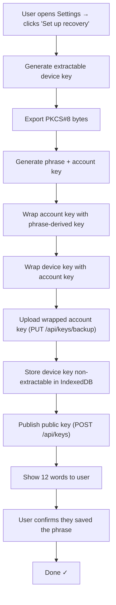
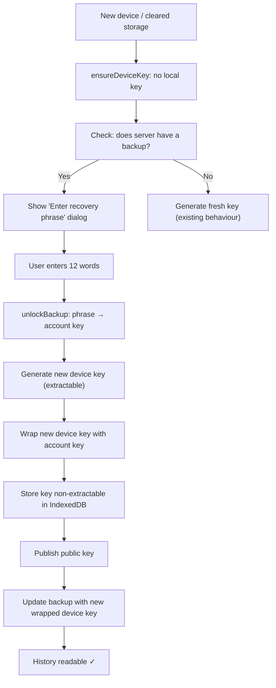

# Step 18 — Key Recovery: Implementation Plan

> [!NOTE]
> The **backend** (entity, migration, controller) and the **crypto library** (`keyRecovery.js`, `createRecoverableDeviceKey`, `importDeviceKey`) are complete. What's missing is the **UI and wiring** that lets users actually use them.

## What needs to be built

### 1. Recovery Setup Card — in Settings tab
**File:** `src/components/editprofile/MessageRecoveryCard.jsx`

A card in the Settings tab (under `ProfileSettingsForm`) that shows:
- **No backup yet →** "Set up message recovery" button, explains that a phrase will protect their message history
- **Backup exists →** "Recovery is active" with date, option to regenerate the phrase or remove recovery

### 2. Recovery Setup Dialog
**File:** `src/components/messages/RecoverySetupDialog.jsx`

A modal shown when the user clicks "Set up recovery":
1. Generates a recoverable device key + phrase via `setUpRecovery`
2. Stores the wrapped device key on the server (via `POST /api/keys` for the device key + `PUT /api/keys/backup` for the account key)
3. **Shows the 12 words** in a grid — the user MUST write these down
4. "Copy phrase" button + confirmation checkbox ("I've saved my recovery phrase")
5. Only then enables "Done"

### 3. Recovery Restore Dialog
**File:** `src/components/messages/RecoveryRestoreDialog.jsx`

A modal shown when a backup exists on the server but this device has no matching private key:
1. Text input for the 12-word phrase
2. Validates phrase form (12 words, all in BIP39 list) + checksum
3. Calls `unlockBackup` → unwraps the account key
4. Uses the account key to generate a new device key, wraps it, and publishes
5. Success → the user's history is now readable on this device

### 4. DeviceKeyPublisher update
**File:** `src/components/messages/DeviceKeyPublisher.jsx`

Currently just calls `ensureDeviceKey` silently. Updated to:
- After `ensureDeviceKey` runs, if the **local key was rotated** (storage cleared) and a backup exists → show a prompt/banner suggesting recovery
- The restore path: unwrap the account key with the phrase, then re-wrap this device's new key under it

### 5. Settings tab integration
**File:** `src/pages/EditProfile/EditProfile.jsx` + `ProfileSettingsForm.jsx`

Add `MessageRecoveryCard` below the existing settings card on the Settings tab.

## Flow Diagrams

### Setup Flow

### Restore Flow

## No backend changes needed
The `KeyBackupController` (GET/PUT/DELETE) and `UserKeyBackup` entity + migration are already in place and verified.
