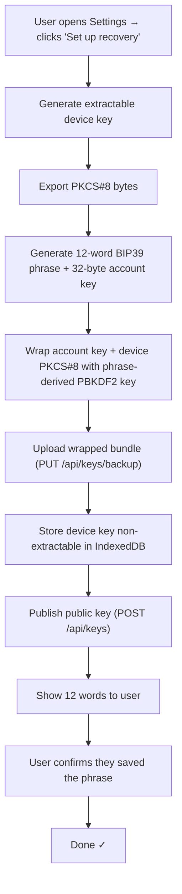
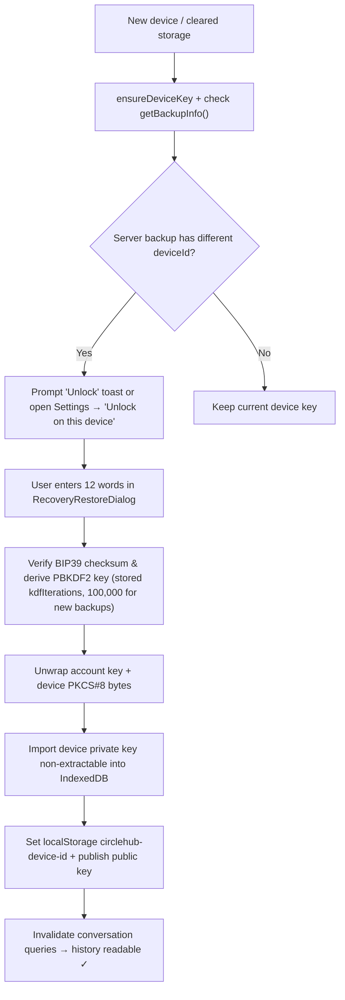

# Steps Implementation Plan & Record

> [!NOTE]
> **Status: Complete, verified, and committed (`0c17ba0`), followed by Web Quality of Life & Layout Polish (`020dcd2`).**
> The backend (`UserKeyBackup`, migration `20261020112344_AddUserKeyBackups`, `KeyBackupController`), the crypto library (`bip39Words.js`, `keyRecovery.js`, `messageCrypto.js`), and the full UI & wiring (`MessageRecoveryCard.jsx`, `RecoverySetupDialog.jsx`, `RecoveryRestoreDialog.jsx`, `DeviceKeyPublisher.jsx`, `EditProfile.jsx`) are implemented and verified.

## What was built (Step 18)

### 1. Recovery Setup Card — in Settings tab
**File:** `src/components/editprofile/MessageRecoveryCard.jsx`

A card in the Settings tab (under `ProfileSettingsForm`) that shows:
- **No backup yet →** "Set up message recovery" button, explains that a phrase will protect their message history
- **Backup exists →** "Recovery is active" badge with formatted timestamp, plus actions to **Unlock on this device**, **Regenerate phrase**, or **Remove backup**

### 2. Recovery Setup Dialog
**File:** `src/components/messages/RecoverySetupDialog.jsx`

A modal shown when the user clicks "Set up recovery" or "Regenerate phrase":
1. Generates a recoverable device key + 12-word BIP39 phrase via `initializeRecovery` (`setUpRecovery`)
2. Stores the wrapped account key and wrapped device key on the server (`PUT /api/keys/backup`) and publishes the device public key (`POST /api/keys`)
3. **Shows the 12 words** in a numbered 3-column grid — the user must save these
4. "Copy phrase" button + confirmation checkbox ("I have saved these 12 words in a safe place…")
5. Only then enables "Done"

### 3. Recovery Restore Dialog
**File:** `src/components/messages/RecoveryRestoreDialog.jsx`

A modal shown when a backup exists on the server and the user unlocks their history on a new browser/device:
1. Textarea input for the 12-word phrase (supports typing or pasting)
2. Live word counter (`x / 12 words`) and live BIP39 wordlist + 4-bit SHA-256 checksum validation (`validatePhrase`)
3. Calls `restoreRecovery` (`unlockBackup`) → unwraps the account key and imports the backed-up device private key as non-extractable into IndexedDB (`circlehub-keyvault`)
4. Re-publishes the device public key (`POST /api/keys`) and refreshes active conversation caches
5. Success → the user's encrypted message history is immediately readable on this device

### 4. DeviceKeyPublisher update
**File:** `src/components/messages/DeviceKeyPublisher.jsx`

Updated to:
- Ensure the local device key is published via `ensureDeviceKey()`
- Check `hasBackup()` once per sign-in unless a `localStorage` flag settles the prompt first (`circlehub-recovery-prompt-dismissed` is written by "Later" or by a successful setup on this browser; `circlehub-recovery-restored` is written by a successful restore; removing the backup clears both)
- If a server backup exists, surface an unobtrusive Sonner toast with an **"Unlock"** action button that opens `RecoveryRestoreDialog` directly, plus a **"Later"** action that persists the dismissal

### 5. Settings tab integration
**File:** `src/pages/EditProfile/EditProfile.jsx`

Rendered `MessageRecoveryCard` below `ProfileSettingsForm` on the Settings tab (`?tab=settings`).

## Flow Diagrams

### Setup Flow

### Restore Flow

---

## Follow-up: Web Quality of Life & Layout Alignment (Step 19 — `020dcd2`)

1. **Categorized Native Emoji Picker (`src/components/messages/EmojiPicker.jsx`)**
   - Dependency-free native Unicode emoji picker across 4 categories (`Smileys & Emotion`, `Hands & Gestures`, `Hearts & Symbols`, `Animals & Food`) with keyword search, click-outside dismissal, and <kbd>Esc</kbd> support.
2. **Auto-Resizing Multiline Composer & Character Counter (`src/components/messages/MessageComposer.jsx`)**
   - Replaced single-line `<input>` with an auto-expanding `<textarea>` (42px to 160px) that wraps long lines cleanly (`placeholder="Write a message..."`).
   - <kbd>Enter</kbd> sends the message; <kbd>Shift</kbd>+<kbd>Enter</kbd> inserts a line break.
   - Displays a subtle live character counter (`x / 4000`) when messages exceed 2,500 characters (turning red above 3,800) to guard against `MAX_PLAINTEXT_LENGTH`.
3. **Failed Message State & 1-Click Retry (`src/components/messages/MessageThread.jsx`, `MessageComposer.jsx`)**
   - Failed sends remain visible with an error border and a **Retry** button that immediately re-sends the message.
4. **Audio Alert Mute Toggles (`src/components/editprofile/ProfileSettingsForm.jsx`, `src/lib/messageChime.js`, `src/lib/notificationChime.js`)**
   - Added **Message Alert Sounds** (`circlehub-mute-message-sound`) and **Notification Alert Sounds** (`circlehub-mute-notification-sound`) toggles in Profile Settings.
5. **Messages & Notifications Width and Layout Consistency (`src/pages/Messages/Messages.jsx`, `src/components/messages/ConversationList.jsx`, `src/pages/Notifications/Notifications.jsx`)**
   - Updated `Messages.jsx` to use `content-stack max-w-[96rem]` (centered, filling the space left by omitting the right sidebar on `/messages`) with the shared `type-headline-responsive` header, subtitle, and `Conversations` card header + count badge.
   - Widened `Notifications.jsx` from `max-w-5xl` to `max-w-7xl` so its content area matches `Explore`, `Communities`, `Followers`, and `EditProfile`.
6. **New Message Dialog (`src/components/messages/NewMessageDialog.jsx`, `src/pages/Messages/Messages.jsx`)**
   - Added a **New Message** button in the Messages header to search connections (`useMessageRecipients`), jump straight to an existing conversation, or compose and send an opening encrypted message to start a new thread.
7. **Mark All as Read on Notifications (`src/pages/Notifications/Notifications.jsx`)**
   - Added a **Mark all as read** button in the `Recent Activity` header when `visitUnreadCount > 0` (`markNotificationsSeen` + `notifications()` query invalidation).
8. **Route-Level & Vendor Code Splitting (`src/routes/lazyPages.jsx`, `src/routes/router.jsx`, `vite.config.js`)**
   - Converted all 18 route pages to `React.lazy` chunks inside `<Suspense>` and configured Rolldown vendor chunk splitting (`vendor-react`, `vendor-ui`, `vendor-signalr`), dropping the entry bundle from ~1,117 kB to 259 kB (84 kB gzip) with zero chunk warnings.
